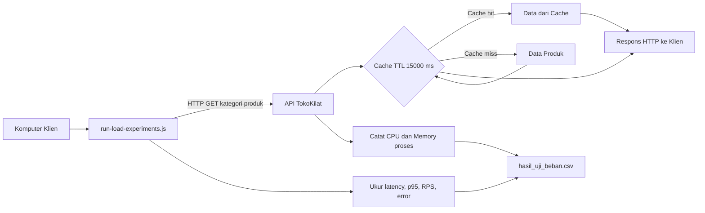
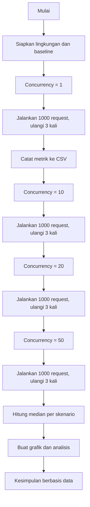
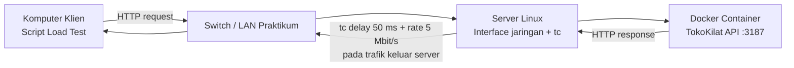
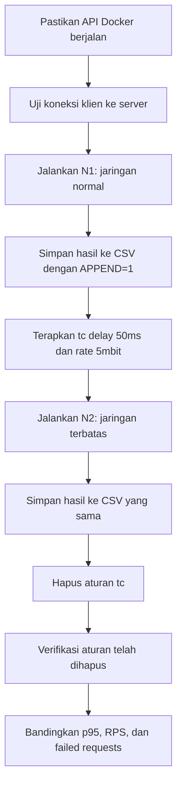

# SOAL ETS PRAKTIKUM — WEB SCALABILITY
## Uji Beban Web Services, Caching, dan Kondisi Jaringan pada API TokoKilat

**Bentuk:** Praktikum dan analisis data  
**Metode eksperimen utama:** OFAT (*One Factor at a Time*)  
**Output utama:** satu file `hasil_uji_beban.csv` dan laporan analisis  
**Ketentuan:** mahasiswa tidak diminta mengubah kode aplikasi. Jalankan script yang disediakan dan ikuti langkah-langkah berikut.


## Diagram visual eksperimen (Mermaid)

Diagram berikut menggunakan Mermaid agar alur eksperimen mudah dipahami. Pada tampilan Markdown yang mendukung Mermaid, kode ini dirender sebagai diagram. Pada dokumen Word, kode sumber disertakan agar dapat disalin ke editor Mermaid jika diperlukan.

### Diagram 1. Arsitektur pengujian utama



### Diagram 2. Alur eksperimen OFAT



### Diagram 3. Topologi network impairment



### Diagram 4. Prosedur skenario jaringan



## A. Deskripsi kasus

TokoKilat adalah layanan e-commerce sederhana yang menyediakan API katalog produk. Tim pengembang ingin mengetahui bagaimana peningkatan jumlah request bersamaan memengaruhi response time, throughput, kegagalan request, cache, serta penggunaan sumber daya server. Tim juga ingin melihat apakah kondisi jaringan yang diberi delay dan pembatasan laju transfer memengaruhi waktu respons yang diamati dari sisi klien.

Anda bertindak sebagai engineer yang menguji layanan. Anda harus mengumpulkan data eksperimen, menyajikan grafik, dan menyusun kesimpulan berdasarkan angka yang benar-benar diperoleh. Jangan mengarang atau mengganti hasil pengukuran.

## B. Capaian praktikum

Setelah menyelesaikan ETS ini, mahasiswa mampu:
1. menjalankan uji beban API menggunakan script yang disediakan;
2. menjelaskan average, p50, p95, p99 response time dan throughput;
3. mengamati failed requests dan statistik cache;
4. mengamati CPU dan memory proses server serta membedakan hitungan operasi filesystem dari disk throughput;
5. membandingkan eksperimen dengan jaringan normal dan jaringan yang diberi impairment;
6. menyimpulkan kemungkinan bottleneck dengan menyebutkan bukti serta keterbatasan pengukuran.

## C. Peralatan dan persiapan

### Peralatan
- Node.js versi 18 atau lebih baru.
- Paket ZIP ETS TokoKilat yang disediakan dosen.
- Microsoft Excel, LibreOffice Calc, atau aplikasi spreadsheet yang dapat membuka CSV.
- Untuk bagian jaringan: dua komputer yang saling terhubung dalam satu jaringan; komputer server menggunakan Linux dengan `tc`/`iproute2`. Komputer klien boleh Windows atau Linux dengan Node.js 18+.

### Langkah persiapan (wajib)
1. Unduh dan ekstrak `Paket_Uji_Beban_TokoKilat.zip` ke folder lokal, misalnya `C:\ETS_TokoKilat`.
2. Buka Terminal, PowerShell, Command Prompt, atau terminal Linux pada folder hasil ekstraksi. Pastikan file `run-load-experiments.js`, `server.js`, `src`, dan `README.txt` terlihat.
3. Periksa Node.js dengan perintah `node --version`. Versi yang tampil harus `v18` atau lebih baru. Jika perintah tidak dikenali, pasang Node.js terlebih dahulu dan buka terminal baru.
4. Tutup server atau program lain yang menggunakan port 3187.
5. Jangan mengubah kode atau parameter eksperimen utama. Script akan menjalankan server lokal secara otomatis.

## D. Bagian 1 — Eksperimen utama: pengaruh concurrency

### Rancangan OFAT
Faktor yang diubah hanya **concurrency**. Endpoint, jumlah request, TTL cache, data, dan lingkungan dijaga tetap.

| Skenario | Concurrency | Request per pengulangan | Pengulangan |
|---|---:|---:|---:|
| A | 1 | 1.000 | 3 |
| B | 10 | 1.000 | 3 |
| C | 20 | 1.000 | 3 |
| D | 50 | 1.000 | 3 |

Total 12 run. Endpoint yang diuji adalah `GET /api/products?category=electronics`; TTL cache adalah 15.000 ms.

### Langkah menjalankan eksperimen utama
1. Pastikan terminal berada pada folder paket.
2. Jalankan:

   ```bash
   node run-load-experiments.js
   ```

3. Script akan memulai server, mengirim request sesuai skenario, mengambil metrik, menghentikan server di akhir setiap pengulangan, lalu melanjutkan skenario berikutnya.
4. Tunggu sampai terminal menampilkan pesan `Selesai` dan lokasi file `hasil_uji_beban.csv`. Jangan tutup terminal sebelum selesai.
5. Buka `hasil_uji_beban.csv` menggunakan Excel atau aplikasi spreadsheet.
6. Simpan salinan cadangan CSV sebelum menjalankan eksperimen tambahan. Jangan mengedit angka hasil pengukuran.

### Metrik yang harus dipahami

**Kinerja API**
- `avg_latency_ms`: rata-rata waktu dari klien mengirim request sampai menerima respons.
- `p50_latency_ms`: median response time; sekitar 50% request selesai pada atau di bawah nilai tersebut.
- `p95_latency_ms`: sekitar 95% request selesai pada atau di bawah nilai tersebut. Gunakan sebagai metrik utama untuk membandingkan keterlambatan.
- `p99_latency_ms`: persentil ke-99, berguna untuk melihat kelompok request yang paling lambat.
- `requests_per_second`: jumlah request yang dicoba dibagi durasi run. Baca bersama jumlah request gagal; jangan menyamakan angka ini dengan jumlah request sukses tanpa memeriksa error.
- `failed_requests`: jumlah request yang gagal atau menghasilkan status HTTP non-OK.
- `duration_seconds`: waktu total satu run.

**Caching**
- `cache_hits`: permintaan yang mendapatkan data dari cache.
- `cache_misses`: permintaan yang tidak menemukan data di cache.
- `cache_hit_ratio`: rasio hit terhadap total hit dan miss; kalikan 100 untuk persen.
- `cache_ttl_ms`: waktu hidup cache dalam milidetik.

**Sumber daya server**
- `server_cpu_time_ms`: waktu CPU proses server yang terpakai selama pengukuran.
- `server_cpu_percent_one_core`: estimasi pemakaian CPU relatif terhadap satu inti selama run. Ini bukan persentase CPU seluruh komputer.
- `server_memory_rss_mb`: RAM resident proses server.
- `server_memory_heap_used_mb`: heap JavaScript Node.js yang sedang digunakan. Heap bukan total RAM proses.
- `server_fs_read_ops_delta` dan `server_fs_write_ops_delta`: perubahan hitungan operasi filesystem proses. Angka ini **bukan** disk throughput MB/s dan bukan disk latency.

**Disk I/O seluruh komputer (observasi tambahan)**
- Pada Windows, buka `Task Manager > Performance > Disk` atau `Resource Monitor > Disk` saat pengujian berjalan. Catat aktivitas disk/Read/Write bila tersedia.
- Karena aplikasi ini menggunakan data dan cache di memori, disk I/O dapat rendah. Jangan menyimpulkan ada kesalahan hanya karena nilainya rendah. Catatan manual dari alat OS harus diberi label sebagai observasi tambahan, bukan data otomatis script.

### Cara membaca response time
Response time diukur otomatis oleh script pada sisi klien, dalam milidetik. Jangan memakai stopwatch. Bandingkan p50, p95, dan p99, bukan hanya rata-rata. Jika p95 naik saat concurrency meningkat sementara RPS mendatar atau turun, sistem mungkin mulai mengalami antrean atau mendekati batas kapasitas. Jika p95 naik tetapi CPU tidak tinggi, pertimbangkan hipotesis lain seperti jaringan, antrean, atau I/O. Semua penjelasan harus disertai bukti dan ditulis sebagai kemungkinan, bukan kepastian tanpa pengukuran pendukung.

## E. Bagian 2 — Eksperimen tambahan: network throttling / impairment

Bagian ini dilakukan setelah eksperimen utama. Tujuannya mengamati pengaruh kondisi jaringan terhadap response time dari klien. **Eksperimen jaringan tidak boleh dilakukan pada `127.0.0.1`/localhost**, karena trafik loopback tidak melewati interface jaringan fisik yang akan diberi pembatasan. Gunakan komputer server dan klien yang berbeda.

### Skenario jaringan
Gunakan concurrency 20, 1.000 request/run, dan 3 pengulangan. Jangan ubah kode, endpoint, data, TTL cache, atau jumlah request.

| Skenario | Kondisi jaringan pada arah keluar server | Tujuan |
|---|---|---|
| N1 | Normal, tanpa `tc` | Baseline jaringan |
| N2 | Delay 50 ms dan rate 5 Mbit/s | Mengamati dampak penundaan dan pembatasan laju respons |

Parameter ini adalah simulasi laboratorium, bukan representasi universal jaringan internet. Aturan `tc` di bawah memengaruhi paket keluar dari interface server menuju klien; ini bukan simulasi dua arah yang sempurna.

### E1. Siapkan server Linux menggunakan Docker (tanpa memasang Node.js langsung di server)
**Tujuan:** menjalankan API TokoKilat di container Docker. Server Linux tidak perlu memasang Node.js secara langsung; yang diperlukan adalah Docker Engine, akses jaringan, dan `tc`/`iproute2` untuk eksperimen impairment.

1. Hubungkan komputer server Linux dan komputer klien ke jaringan yang sama. Pastikan Docker Engine sudah tersedia di server dengan perintah:

   ```bash
   docker --version
   ```

   Jika perintah tidak ditemukan, minta administrator/dosen menyiapkan Docker Engine sesuai distribusi Linux. Jangan memasang perangkat lunak pada server tanpa izin.

2. Ekstrak paket ETS pada server Linux, lalu masuk ke folder `ETS_TokoKilat_UjiBeban` yang berisi `Dockerfile`, `server.js`, dan folder `src`. Periksa isi folder:

   ```bash
   ls
   ```

3. Bangun image Docker dari folder tersebut:

   ```bash
   docker build -t tokokilat-api .
   ```

   Tunggu hingga proses selesai tanpa pesan error. Perintah ini membuat image lokal bernama `tokokilat-api`.

4. Jalankan container pada port 3187 menggunakan host networking:

   ```bash
   docker run --rm --name tokokilat-api --network host -e PORT=3187 -e CACHE_TTL_MS=15000 tokokilat-api
   ```

   **Jangan tutup terminal ini selama eksperimen.** `--network host` membuat container memakai network namespace host Linux sehingga aturan `tc` pada interface host dapat memengaruhi paket keluar server. Opsi ini ditujukan untuk Linux; perilakunya berbeda pada Docker Desktop Windows/macOS. Pastikan port 3187 belum digunakan.

5. Pada terminal server yang lain, cari alamat IP server yang dapat dijangkau klien:

   ```bash
   hostname -I
   ```

   Catat IP yang sesuai jaringan praktikum, misalnya `192.168.1.20`; gunakan IP aktual, bukan contoh tersebut.

6. Dari komputer klien, buka browser dan akses `http://IP_SERVER:3187/` dengan mengganti `IP_SERVER` menggunakan alamat aktual. Jika ingin menguji dari terminal klien, jalankan:

   ```bash
   curl http://IP_SERVER:3187/
   ```

   Respons yang diharapkan berupa JSON yang menyebut layanan `TokoKilat API` dan daftar endpoint.

7. Jika koneksi gagal, periksa apakah container masih berjalan, IP server benar, klien dan server berada pada jaringan yang dapat saling menjangkau, port 3187 tidak diblokir firewall, dan tidak ada proses lain yang memakai port tersebut. Jika firewall perlu diubah, izinkan akses hanya dari jaringan praktikum yang dipercaya.

8. Setelah seluruh eksperimen selesai, hentikan container dengan menekan `Ctrl+C` pada terminal yang menjalankan `docker run`. Karena perintah memakai `--rm`, container akan dihapus setelah berhenti; image `tokokilat-api` tetap tersedia secara lokal.

### E2. Cari interface jaringan server
1. Di server Linux, cari IP komputer klien. Pada klien Windows gunakan `ipconfig`; pada Linux gunakan `ip addr`.
2. Di server, jalankan perintah berikut dengan mengganti `IP_KLIEN`:

   ```bash
   ip route get IP_KLIEN
   ```

3. Cari bagian `dev`, misalnya `dev enp0s3` atau `dev eth0`. Catat nama interface tersebut sebagai `IFACE`. Jangan menebak nama interface.

### E3. Jalankan baseline jaringan normal (N1)
Pada komputer klien, buka terminal di folder paket. Gunakan perintah sesuai sistem operasi.

**Windows PowerShell:**

```powershell
$env:EXTERNAL_SERVER="1"
$env:BASE_URL="http://IP_SERVER:3187"
$env:CONCURRENCY_LEVELS="20"
$env:REQUESTS="1000"
$env:REPEATS="3"
$env:SCENARIO_PREFIX="network_normal"
$env:APPEND="1"
node run-load-experiments.js
```

**Linux/macOS shell:**

```bash
EXTERNAL_SERVER=1 BASE_URL=http://IP_SERVER:3187 CONCURRENCY_LEVELS=20 REQUESTS=1000 REPEATS=3 SCENARIO_PREFIX=network_normal APPEND=1 node run-load-experiments.js
```

Ganti `IP_SERVER` dengan IP server sebenarnya. `APPEND=1` menambahkan baris ke `hasil_uji_beban.csv` yang sudah ada, sehingga hasil eksperimen utama tetap berada di file yang sama. Pastikan file CSV hasil eksperimen utama sudah ada sebelum memakai opsi append.

### E4. Terapkan network impairment pada server
1. Lakukan langkah ini hanya pada server Linux praktikum yang disetujui dosen. Perintah memengaruhi trafik keluar interface yang dipilih.
2. Ganti `IFACE` dengan nama interface yang ditemukan pada langkah E2.
3. Terapkan delay 50 ms dan rate 5 Mbit/s:

   ```bash
   sudo tc qdisc add dev IFACE root netem delay 50ms rate 5mbit
   ```

4. Periksa aturan yang aktif:

   ```bash
   tc qdisc show dev IFACE
   ```

5. Jika perintah gagal karena `tc` belum tersedia, jangan mengunduh atau memasang alat tanpa izin. Catat kendala dan minta bantuan dosen/asisten.

### E5. Jalankan skenario jaringan terbatas (N2)
Saat aturan `tc` masih aktif, jalankan perintah yang sama seperti E3, tetapi ganti `SCENARIO_PREFIX` menjadi `network_delay50ms_rate5mbit`.

**Windows PowerShell:**

```powershell
$env:SCENARIO_PREFIX="network_delay50ms_rate5mbit"
$env:APPEND="1"
node run-load-experiments.js
```

**Linux/macOS shell:**

```bash
EXTERNAL_SERVER=1 BASE_URL=http://IP_SERVER:3187 CONCURRENCY_LEVELS=20 REQUESTS=1000 REPEATS=3 SCENARIO_PREFIX=network_delay50ms_rate5mbit APPEND=1 node run-load-experiments.js
```

Jika menggunakan PowerShell, variabel `EXTERNAL_SERVER`, `BASE_URL`, `CONCURRENCY_LEVELS`, `REQUESTS`, dan `REPEATS` dari langkah E3 masih berlaku pada jendela terminal yang sama. Jika membuka terminal baru, tetapkan kembali seluruh variabel tersebut.

### E6. Hapus aturan jaringan setelah pengujian (wajib)
Setelah pengujian selesai, pada server Linux jalankan:

```bash
sudo tc qdisc del dev IFACE root
```

Ganti `IFACE` dengan interface yang sama. Periksa kembali dengan `tc qdisc show dev IFACE`. Pastikan aturan impairment telah dihapus agar tidak memengaruhi pengguna atau pengujian lain. Jangan menerapkan aturan ini pada komputer produksi atau jaringan yang bukan milik/izin Anda.

### E7. Catatan interpretasi jaringan
- `avg_latency_ms`, `p50_latency_ms`, `p95_latency_ms`, dan `p99_latency_ms` merupakan response time dari sisi klien, sehingga mencakup waktu perjalanan jaringan dan waktu pemrosesan API.
- Jika response time N2 lebih tinggi daripada N1, hasil tersebut konsisten dengan adanya tambahan delay/pembatasan jaringan, tetapi besarnya pengaruh perlu dilihat dari data.
- CPU server bisa tetap rendah meskipun response time klien meningkat, karena server mungkin sedang menunggu jaringan atau respons sedang tertunda saat keluar dari server.
- Karena pembatasan diterapkan pada arah keluar server, hasilnya bukan pengukuran lengkap kualitas jaringan dua arah. Jelaskan keterbatasan ini dalam laporan.
- Jika tidak tersedia dua komputer atau Linux/`tc`, jangan mengklaim telah menguji network throttling. Laporkan keterbatasan fasilitas dan analisis hasil utama saja sesuai arahan dosen.

## F. File hasil dan pengelolaan data
Semua skenario disimpan dalam satu `hasil_uji_beban.csv`:
- `row_type=run`: hasil satu pengulangan.
- `row_type=summary`: median dari tiga pengulangan untuk satu skenario.
- `scenario`: nama skenario. Eksperimen utama menggunakan awalan `concurrency`; jaringan normal menggunakan `network_normal`; jaringan terbatas menggunakan `network_delay50ms_rate5mbit`.
- `APPEND=1`: menambahkan hasil ke file yang sudah ada. Jangan gunakan jika file sebelumnya belum ada atau jika Anda ingin memulai dataset baru.

Simpan salinan CSV asli. Jangan mengganti nilai yang dianggap aneh. Jika ada hasil tidak wajar, tulis sebagai temuan dan jelaskan kemungkinan penyebabnya.

## G. Grafik wajib
1. Concurrency vs median p95 response time (ms).
2. Concurrency vs median RPS.
3. Concurrency vs median failed requests.
4. Concurrency vs median CPU% dan memory RSS (buat grafik terpisah jika skala berbeda).
5. Untuk bagian jaringan: bandingkan median p95 latency N1 dan N2, serta median RPS dan failed requests. Beri judul grafik yang jelas.

Gunakan baris `summary` untuk membandingkan skenario. Jangan gabungkan latency (ms) dan throughput (RPS) dalam satu sumbu Y.

## H. Pertanyaan ETS
1. Bagaimana average, p50, p95, dan p99 response time berubah ketika concurrency dinaikkan dari 1 menjadi 50?
2. Pada concurrency berapa p95 mulai meningkat paling jelas? Apakah RPS masih meningkat pada skenario itu?
3. Apakah jumlah failed requests berubah saat concurrency bertambah? Tunjukkan angka pendukung.
4. Bagaimana CPU time dan estimasi CPU% berubah? Apakah data cukup untuk menyatakan CPU sebagai bottleneck?
5. Apakah RAM RSS dan heap used stabil atau meningkat? Jelaskan perbedaan kedua metrik tersebut.
6. Apa arti cache hits, misses, dan hit ratio pada eksperimen ini? Apakah cache hit ratio sendiri cukup untuk membuktikan bahwa cache meningkatkan performa?
7. Apa yang ditunjukkan hitungan filesystem read/write? Mengapa angka itu tidak boleh dianggap sebagai disk throughput MB/s?
8. Bandingkan network normal (N1) dengan network impairment (N2). Apa perubahan pada p95, RPS, dan failed requests? Hubungkan dengan lokasi pengukuran response time.
9. Jika p95 naik tetapi CPU server tidak meningkat, sebutkan sedikitnya dua penjelasan alternatif dan data tambahan apa yang dibutuhkan untuk mengujinya.
10. Berdasarkan hasil eksperimen, skenario mana yang paling sesuai untuk kondisi uji ini? Jelaskan trade-off antara response time, throughput, error, cache, dan sumber daya.
11. Sebutkan sedikitnya tiga keterbatasan eksperimen dan hindari menggeneralisasi hasil laboratorium sebagai kapasitas produksi.

## I. Berkas yang dikumpulkan
1. Satu file `hasil_uji_beban.csv` yang berisi data pengukuran dan ringkasan.
2. Laporan singkat berisi tujuan, konfigurasi komputer, tabel ringkasan median, grafik wajib, jawaban pertanyaan ETS, serta kesimpulan berbasis data.
3. Jika bagian jaringan tidak dapat dilakukan karena fasilitas, nyatakan alasan dan bukti kendalanya. Jangan mengisi data jaringan dengan angka perkiraan.

## J. Rubrik penilaian (100 poin)
- Kelengkapan dan keaslian data CSV: 20 poin.
- Ketepatan tabel/grafik dan satuan: 20 poin.
- Analisis response time, throughput, dan failed requests: 20 poin.
- Analisis cache, CPU, memory, dan I/O: 20 poin.
- Analisis jaringan, keterbatasan, dan kesimpulan berbasis bukti: 20 poin.

**Peringatan:** jangan menjalankan load test atau `tc` terhadap layanan publik/produksi tanpa izin tertulis. Jalankan hanya pada paket praktikum dan jaringan yang disetujui dosen.
